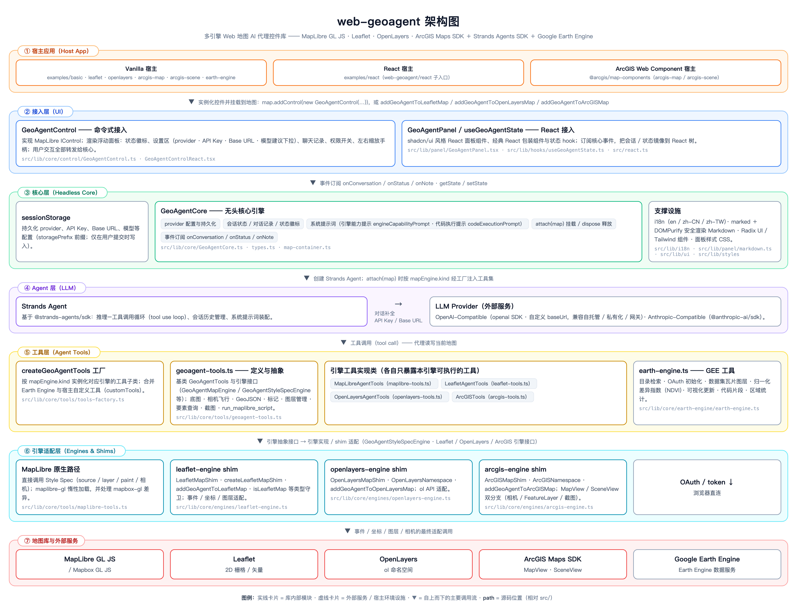

# web-geoagent

**[English](README.md) | [简体中文](README.zh-CN.md)**

面向 Web 地图的纯浏览器 GeoAgent。原生控件实现 MapLibre 的 `IControl` 接口，
内嵌一个 Strands TypeScript agent，可以通过专用的浏览器工具查看并操作当前
地图；同一核心还可通过兼容 shim attach 到 Leaflet、OpenLayers 与 ArcGIS Maps SDK 地图（MapView / SceneView）。

[](https://www.npmjs.com/package/web-geoagent)
[](https://opensource.org/licenses/MIT)

## 架构总览



## 功能特性

- 可折叠的 MapLibre 控件，带浮动聊天面板
- 浏览器端 provider 界面，支持 OpenAI 兼容与 Anthropic 兼容的自定义端点（自托管服务、私有化部署与网关）
- API key 在提交时（回车或失焦）才保存，并有行内确认提示；provider 报错在发送 prompt 时展示
- provider、key 与模型设置集中在一个可折叠区块中，配置完成后自动收起；内置 provider 默认使用其最新配置模型，模型仍可手动修改
- 地图工具覆盖相机移动、投影、底图、标记点、GeoJSON、XYZ 瓦片、图层可见性、透明度、要素查询、截图与图层清理
- 可选的 Google Earth Engine 工具：目录检索、OAuth 初始化、数据集瓦片图层、归一化差异指数、可视化更新、代码片段与区域统计
- 可选的 MapLibre JavaScript 执行工具，默认关闭
- 破坏性图层删除工具由独立开关控制
- 可将可见的对话日志复制为 Markdown
- 提供无头 `GeoAgentCore`、shadcn/ui 风格的 React `GeoAgentPanel`，以及经典的 React 包装组件与状态 hook
- 按引擎划分的工具类层次：共享基类 `GeoAgentTools` 之下有 `MapLibreAgentTools`、`LeafletAgentTools`、`OpenLayersAgentTools`、`ArcGISTools` 四个子类——每个子类只暴露该引擎真正能执行的 Strands 工具，`createGeoAgentTools` 会根据 `mapEngine` 选择正确的子类

## 安装

```bash
npm install web-geoagent maplibre-gl
```

`maplibre-gl` 是**可选** peer 依赖：它只是默认引擎的命名空间，在第一次工具
调用时才被惰性加载。Leaflet 与 OpenLayers 宿主在运行时永远不会加载它，可以
只安装自己用到的包（如 `npm install web-geoagent leaflet`）。注意：多数
bundler 在构建期仍会静态解析这条惰性 `import("maplibre-gl")`——如果构建时
报告找不到该模块，把它加为 dev 依赖或标记为 external 即可。

## 原生 JS/TS 用法

```typescript
import maplibregl from "maplibre-gl";
import { GeoAgentControl } from "web-geoagent";
import "maplibre-gl/dist/maplibre-gl.css";
import "web-geoagent/style.css";

const map = new maplibregl.Map({
  container: "map",
  style: "https://tiles.openfreemap.org/styles/liberty",
  center: [-98.5795, 39.8283],
  zoom: 3,
  maxPitch: 85,
  canvasContextAttributes: { preserveDrawingBuffer: true },
});

map.on("load", () => {
  map.addControl(
    new GeoAgentControl({
      title: "GeoAgent",
      collapsed: false,
    }),
    "top-left",
  );
});
```

## React 用法

```tsx
import { useEffect, useRef, useState } from "react";
import maplibregl, { type Map } from "maplibre-gl";
import {
  GeoAgentControlReact,
  useGeoAgentState,
} from "web-geoagent/react";
import "maplibre-gl/dist/maplibre-gl.css";
import "web-geoagent/style.css";

function App() {
  const mapContainer = useRef<HTMLDivElement>(null);
  const [map, setMap] = useState<Map | null>(null);
  const { state, setState } = useGeoAgentState({ collapsed: false });

  useEffect(() => {
    if (!mapContainer.current) return;

    const mapInstance = new maplibregl.Map({
      container: mapContainer.current,
      style: "https://tiles.openfreemap.org/styles/liberty",
      center: [-98.5795, 39.8283],
      zoom: 3,
      canvasContextAttributes: { preserveDrawingBuffer: true },
    });

    mapInstance.on("load", () => setMap(mapInstance));
    return () => mapInstance.remove();
  }, []);

  return (
    <>
      <div ref={mapContainer} style={{ width: "100vw", height: "100vh" }} />
      {map && (
        <GeoAgentControlReact
          map={map}
          title="GeoAgent"
          collapsed={state.collapsed}
          position="top-left"
          onStateChange={setState}
        />
      )}
    </>
  );
}
```

## React 面板（shadcn/ui）

`GeoAgentPanel` 把整个聊天 UI 渲染为 shadcn/ui + Tailwind CSS 4 风格的
React 组件（供应商下拉、可折叠设置、对话日志、提示词表单），本项目演示站
使用的就是它。可以把它渲染到任何位置——侧栏、停靠列或 Portal——并把地图
交给它；无头核心会自动创建并在卸载时销毁：

```tsx
import { GeoAgentPanel } from "web-geoagent/react";
import "web-geoagent/style.css";

<GeoAgentPanel map={map} collapsed={false} title="GeoAgent" showCollapseButton={false} />;
```

Leaflet/OpenLayers 宿主与原生控件一样传入 `mapEngine` 选项；面板会在挂载时
attach 地图，并在地图实例变化时重新 attach。若要自行控制生命周期，可以
构造主入口导出的 `GeoAgentCore`，调用 `core.attach(map)` 后通过 `core`
prop 传入——此时面板不会替你销毁它：

```tsx
import { GeoAgentCore } from "web-geoagent";
import { GeoAgentPanel } from "web-geoagent/react";

const core = new GeoAgentCore({ title: "GeoAgent", locale: "zh-CN" });
<GeoAgentPanel core={core} map={map} showCollapseButton={false} />;
```

说明：

- `GeoAgentPanel` 不包含浮动定位与拖拽调整尺寸；它填满容器（默认宽度
  390px，可用 `width` 覆盖）。浮动的、可调整尺寸的面板仍由原生
  `GeoAgentControl` 提供。
- 面板按钮为 发送 / 取消 / 复制 Markdown。`GeoAgentCore` 仍暴露
  `clearConversation()`，宿主可自行实现清空入口。
- 样式随包内唯一的 `web-geoagent/style.css` 导出分发：Tailwind
  工具类编译时不含 preflight（全局不会泄漏任何重置样式），设计令牌使用
  `--geoagent-*` 前缀变量。
- **相对早期版本的破坏性变更：** 厂商直连 provider（OpenAI Responses、
  OpenAI Chat、Anthropic、Google Gemini、Amazon Bedrock）已移除——
  `GeoAgentProviderId` 现为 `'openai-compatible' | 'anthropic-compatible'`，
  默认 provider 为 `openai-compatible`；随 Amazon Bedrock 一并移除，
  `GeoAgentState.bedrockRegion` 已删除；包名由 `maplibre-gl-geoagent` 更名为
  `web-geoagent`——默认 `storagePrefix` 变为 `web-geoagent`，此前保存在
  `geoagent.maplibre.*` 下的 sessionStorage 键不再被读取（用户需重新输入一次
  API key）。

## 模型提供商

支持的 provider（均为自定义端点——不内置任何厂商直连凭据）：

- OpenAI-Compatible（自定义）
- Anthropic-Compatible（自定义）

选择 `OpenAI-Compatible (Custom)` 或 `Anthropic-Compatible (Custom)`，输入对应
兼容端点的 API base URL（例如本地 LLM 服务、私有化部署或网关），提供 API
key 并填写模型 ID。OpenAI 兼容端点按 OpenAI Chat Completions API 的请求格式
调用（`https://host/v1`）；Anthropic 兼容 provider 走 Anthropic Messages API
（`https://host`）。厂商直连 provider（OpenAI Responses/Chat、Anthropic、
Google Gemini、Amazon Bedrock）已移除——请将兼容 provider 指向网关或代理。

### 保存 key 与模型

API key 只在你提交时（按回车或焦点移出输入框）写入 `sessionStorage`，因此
输入一半的 key 不会把状态徽章变成 "Ready"，也不会被写入存储。

内置 provider 使用包内配置的最新模型：Anthropic-Compatible 为
`claude-opus-4-8`。"Use latest" 按钮会把模型输入框重置为该配置默认值，不会
调用 provider 的模型列表接口。`OpenAI-Compatible (Custom)` 没有通用的最新
模型，请填写该端点暴露的模型 ID。

### 部署默认值（.env）

宿主应用可以通过环境变量预填面板，让配置好的部署开箱即用。本仓库的演示站从
`.env` 读取三个 Vite 变量（通过 `LLM_` `envPrefix` 暴露）：

```env
LLM_API_URL=https://llm.example.com/v1
LLM_API_KEY=sk-...
LLM_API_MODEL=your-model-id
```

它们映射到 `GeoAgentPanel` / `GeoAgentCore` 的 `defaultBaseUrl` /
`defaultApiKey` / `defaultModel` 选项（演示站在 `src/demo/env.ts` 中读取，
绝不会内联进发布的包）。优先级：面板保存的 `sessionStorage` 值 >
`apiKeys` > 这些默认值；面板以它们预填，任何在面板中提交的修改都会持久化
并接管。

### 语言

将 `locale` 选项设为 `'zh-CN'` 即可以中文渲染面板的全部文案（标签、状态徽章、
按钮与运行时消息），默认 `'en'` 为英文。品牌名与技术术语在两种语言下保持一致。
示例首页提供中英文下拉框，选择保存在 `localStorage`（`geoagent.locale`），
各示例页会读取该选择并跟随显示，参见 `src/demo/locale.ts`。

## 配置项

| 选项                           | 类型                                                           | 默认值              |
| ------------------------------ | -------------------------------------------------------------- | ------------------- |
| `collapsed`                    | `boolean`                                                      | `true`              |
| `position`                     | `'top-left' \| 'top-right' \| 'bottom-left' \| 'bottom-right'` | `'top-right'`       |
| `title`                        | `string`                                                       | `'GeoAgent'`        |
| `panelWidth`                   | `number`                                                       | `390`               |
| `panelMinWidth`                | `number`                                                       | `320`               |
| `panelMaxWidth`                | `number`                                                       | `720`               |
| `className`                    | `string`                                                       | `''`                |
| `locale`                       | `'en' \| 'zh-CN'`                                              | `'en'`              |
| `defaultProvider`              | `GeoAgentProviderId`                                           | `'openai-responses'`|
| `defaultModel`                 | `string \| Partial<Record<GeoAgentProviderId, string>>`        | provider 默认值     |
| `storagePrefix`                | `string`                                                       | `'web-geoagent'`|
| `apiKeys`                      | `Partial<Record<GeoAgentProviderId, string>>`                  | `undefined`         |
| `allowCodeExecutionDefault`    | `boolean`                                                      | `true`              |
| `allowDestructiveToolsDefault` | `boolean`                                                      | `true`              |
| `showPermissionToggles`        | `boolean`                                                      | `false`             |
| `basemaps`                     | `Record<string, string \| StyleSpecification>`                 | 内置底图            |
| `earthEngine`                  | `EarthEngineOptions`                                           | `undefined`         |
| `mapEngine`                    | `GeoAgentMapEngine`                                            | maplibre-gl         |

### 在 Mapbox GL JS 上运行

几乎所有工具都停留在 `maplibre-gl` 与 `mapbox-gl` 共享的 Style Spec 表面上。
有四个工具做不到，一次性声明引擎正是为了让它们保持诚实：

- `add_marker` 构造引擎自己的 `Marker` 与 `Popup`（MapLibre 的版本会读取
  `map._camera.transform`，在 mapbox-gl 地图上会抛错），
- `set_projection` 在 MapLibre 写 `{ type: 'globe' }`、在 Mapbox 写 `'globe'`，
- `get_map_state` 读取 `{ type }` 或 `{ name }`，
- `run_maplibre_script` 把引擎自己的命名空间交给用户代码。

```javascript
import mapboxgl from 'mapbox-gl';

const agent = new GeoAgentControl({
  mapEngine: { kind: 'mapbox', namespace: mapboxgl },
});

map.addControl(agent);
```

`namespace` 必须是真实的库命名空间，不能是子集：`run_maplibre_script` 会把
整个对象交给它运行的脚本。省略 `mapEngine` 时工具使用本包自带的
`maplibre-gl`，行为与以前完全一致。

无论哪种引擎都有一个工具仍是 MapLibre 专属：`set_sky` / `clear_sky` 调用
`map.setSky`，而 mapbox-gl 没有该方法（它通过样式图层绘制天空）。工具会
明确报告这一点，而不是静默失败。

### 在 Leaflet 上运行

同样的工具也可以运行在纯 [Leaflet](https://leafletjs.com/) 地图上，由
`LeafletAgentTools` 驱动——它是共享基类 `GeoAgentTools` 的子类，
`createGeoAgentTools` 会根据 `mapEngine.kind` 选中它。Leaflet
没有 Style Spec，因此该子类驱动一个兼容引擎（`leaflet-engine.ts`）：一个在
真实 `L.Map` 之上模拟 MapLibre map API 的 shim，把 Style Spec 的
source/layer 物化为 Leaflet 图层（每个 Style Spec 图层对应 GeoJSON/vector
图层，raster source 对应瓦片图层，用每层独立 pane 控制 z-order 与可见性，
用表达式求值器处理 `["get", ...]`/`["step", ...]`/`["match", ...]` 过滤器与
paint，用贪心像素网格聚类实现 `cluster: true` 的 source）。

```javascript
import L from 'leaflet';
import { GeoAgentControl, addGeoAgentToLeafletMap } from 'web-geoagent';
import 'web-geoagent/dist/web-geoagent.css';
import 'leaflet/dist/leaflet.css';

const map = L.map('map').setView([39.8283, -98.5795], 4);
L.tileLayer('https://tile.openstreetmap.org/{z}/{x}/{y}.png', {
  attribution: '&copy; OpenStreetMap contributors',
}).addTo(map);

const agent = new GeoAgentControl({
  mapEngine: { kind: 'leaflet', namespace: L },
});

// Leaflet 的 map.addControl 不接受外部控件，因此通过助手挂载——
// 它会挂到 Leaflet 的角落 DOM 上，并返回 { remove() } 用于卸载。
addGeoAgentToLeafletMap(agent, map, { position: 'topleft' });
```

设计上支持和不支持的能力：

- 相机（`set_center`、`fly_to`、`zoom_to_bounds`、`get_map_state`）、所有
  GeoJSON/raster/marker 覆盖物、图层可见性/透明度、要素查询
  （`query_rendered_features` 做像素级命中测试）、底图切换（具名 MapLibre
  样式会解析为 raster 瓦片 URL——矢量样式无法在 Leaflet 中渲染），以及
  `run_maplibre_script`（用户代码拿到真实的 `L.Map`（绑定名 `map`）与
  Leaflet 命名空间（绑定名 `L`），工具描述会告知模型编写 Leaflet 代码——
  其中的脚本就是 Leaflet 脚本）。
- Leaflet 是纯 2D 引擎，且 agent 事先知情：仅 WebGL 引擎支持的工具
  （`set_projection`、`add_terrain`/`clear_terrain`、`set_sky`/`remove_sky`、
  `add_3d_buildings`、`screenshot_map`）在该引擎下会从工具列表中移除，
  system prompt 也会声明 2D 能力边界。直接通过 `runCommand` 调用它们仍会
  报告不支持，而不是静默失败。
- Leaflet 宿主在运行时永远不会加载 `maplibre-gl`：本包只在默认的 MapLibre
  引擎下才惰性导入它。
- Earth Engine 瓦片以普通 XYZ raster 覆盖物加载。

### 在 OpenLayers 上运行

同样的工具也可以运行在纯 [OpenLayers](https://openlayers.org/) 地图上，由
`OpenLayersAgentTools` 驱动——同样是共享基类 `GeoAgentTools` 的子类。该子类
驱动第二个兼容引擎（`openlayers-engine.ts`）：一个在真实 `ol/Map` 之上模拟
MapLibre map API 的 shim，把 Style Spec 的 source/layer 物化为 OpenLayers
图层（每个 Style Spec 图层对应一个 `VectorLayer`，其 style function 求值
fill/line/circle/symbol 的 paint 与 `["get", ...]`/`["step", ...]`/
`["match", ...]` 过滤器；raster source 对应 `TileLayer` + `XYZ`；
`cluster: true` 的 source 用贪心像素网格聚类并在 `moveend` 时重算）。

库本身不 import `ol`，因此由宿主一次性组装一个 ol 类命名空间：

```javascript
import Map from 'ol/Map';
import View from 'ol/View';
import Feature from 'ol/Feature';
import Overlay from 'ol/Overlay';
import Point from 'ol/geom/Point';
import TileLayer from 'ol/layer/Tile';
import VectorLayer from 'ol/layer/Vector';
import XYZ from 'ol/source/XYZ';
import VectorSource from 'ol/source/Vector';
import GeoJSON from 'ol/format/GeoJSON';
import { Style, Fill, Stroke, Circle as CircleStyle, Text } from 'ol/style';
import { fromLonLat, toLonLat, transformExtent } from 'ol/proj';
import { GeoAgentControl, addGeoAgentToOpenLayersMap } from 'web-geoagent';
import 'web-geoagent/dist/web-geoagent.css';
import 'ol/ol.css';

const map = new Map({
  target: 'map',
  layers: [
    new TileLayer({
      source: new XYZ({ url: 'https://tile.openstreetmap.org/{z}/{x}/{y}.png' }),
    }),
  ],
  view: new View({ center: fromLonLat([-98.5795, 39.8283]), zoom: 4 }),
});

const agent = new GeoAgentControl({
  mapEngine: {
    kind: 'openlayers',
    namespace: {
      Feature, Point, Overlay, VectorLayer, TileLayer, VectorSource, XYZ,
      GeoJSON, Style, Fill, Stroke, CircleStyle, Text,
      fromLonLat, toLonLat, transformExtent,
    },
  },
});

// OpenLayers 的 map.addControl 不接受外部控件，因此通过助手挂载——
// 它会挂到地图 viewport 上，并返回 { remove() } 用于卸载。
addGeoAgentToOpenLayersMap(agent, map, { position: 'top-left' });
```

设计上支持和不支持的能力：

- 相机（`set_center`、`fly_to`、`zoom_to_bounds`、`get_map_state`；bearing
  映射为视图旋转，pitch 恒为 0）、所有 GeoJSON/raster/marker 覆盖物
  （marker 变为 `ol/Overlay` 图钉，点击弹出 popup）、图层可见性/透明度、
  要素查询（`query_rendered_features` 做像素级命中测试，首帧渲染前退化为
  纯 Web Mercator 数学计算）、底图切换（具名 MapLibre 样式解析为 raster
  瓦片 URL），以及 `run_maplibre_script`（用户代码拿到真实的 `ol/Map`
  （绑定名 `map`）与你提供的命名空间（绑定名 `ol`），工具描述会告知模型
  编写 OpenLayers 代码——其中的脚本就是 OpenLayers 脚本）。
- OpenLayers 在本集成中是 2D 引擎，且 agent 事先知情：仅 WebGL 引擎支持的
  工具（`set_projection`、`add_terrain`/`clear_terrain`、
  `set_sky`/`remove_sky`、`add_3d_buildings`、`screenshot_map`）在该引擎下
  会从工具列表中移除，system prompt 也会声明 2D 能力边界。直接通过
  `runCommand` 调用它们——或要求 `fill-extrusion`/`heatmap` 图层、矢量瓦片
  source——仍会报告不支持，而不是静默失败。
- OpenLayers 宿主在运行时永远不会加载 `maplibre-gl`：本包只在默认的
  MapLibre 引擎下才惰性导入它。
- Earth Engine 瓦片以普通 XYZ raster 覆盖物加载。

### 在 ArcGIS Maps SDK 上运行（含 @arcgis/map-components）

同样的工具也可以运行在 [ArcGIS Maps SDK for JavaScript](https://developers.arcgis.com/javascript/)
的 `MapView`（平面 2D）**或** `SceneView`（3D 球体）上——包括
[`@arcgis/map-components`](https://developers.arcgis.com/javascript/latest/get-started/npm/#use-map-components)
提供的 `<arcgis-map>` / `<arcgis-scene>` web component——由 `ArcGISTools`
驱动，同样是共享基类 `GeoAgentTools` 的子类。该子类驱动一个兼容引擎
（`arcgis-engine.ts`）：在真实视图之上模拟 MapLibre map API 的 shim，把
Style Spec 的 source/layer 物化为 ArcGIS 图层（raster XYZ →
`WebTileLayer`；GeoJSON → 客户端 `FeatureLayer`，其 graphic 携带由共享
MapLibre 表达式引擎逐要素求值的符号；`cluster: true` 源做贪心像素网格
聚类）。`change_basemap` 传入 ArcGIS 原生底图名（`satellite`、`topo`、
`dark-gray` 等）会直接切换地图自身的 basemap。`mapEngine.viewKind` 选项
声明宿主传入的是哪种视图：`"map"`（默认，MapView）或 `"scene"`
（SceneView）——shim 按视图种类适配相机模型（scene 下 zoom 走视图 scale、
bearing 走 `camera.heading`、pitch 走 `camera.tilt`，marker 与要素查询用
视图精确的 `toScreen` 投影定位），系统提示词也会描述对应的几何。

库本身从不 import `@arcgis/*`，由宿主一次性组装一个小的 esri 类命名空间：

```javascript
import WebTileLayer from '@arcgis/core/layers/WebTileLayer';
import FeatureLayer from '@arcgis/core/layers/FeatureLayer';
import Graphic from '@arcgis/core/Graphic';
import SimpleFillSymbol from '@arcgis/core/symbols/SimpleFillSymbol';
import SimpleLineSymbol from '@arcgis/core/symbols/SimpleLineSymbol';
import SimpleMarkerSymbol from '@arcgis/core/symbols/SimpleMarkerSymbol';
import TextSymbol from '@arcgis/core/symbols/TextSymbol';
import PictureMarkerSymbol from '@arcgis/core/symbols/PictureMarkerSymbol';
import { GeoAgentControl, addGeoAgentToArcGISMap } from 'web-geoagent';
import 'web-geoagent/dist/web-geoagent.css';

const view = new MapView({
  container: 'viewDiv',
  map: new WebMap({ basemap: 'topo' }),
  center: [-98.5795, 39.8283],
  zoom: 4,
});

const agent = new GeoAgentControl({
  mapEngine: {
    kind: 'arcgis',
    // 'map'（MapView，默认）或 'scene'（SceneView）。
    viewKind: 'map',
    namespace: {
      WebTileLayer, FeatureLayer, Graphic,
      SimpleFillSymbol, SimpleLineSymbol, SimpleMarkerSymbol, TextSymbol,
      PictureMarkerSymbol,
    },
  },
});

// ArcGIS 的 map.addControl 不接受外部控件，因此通过助手挂载——它附加到
// view 容器并返回 { remove() } 用于卸载。
addGeoAgentToArcGISMap(agent, view, { position: 'top-left' });
```

使用 `@arcgis/map-components` 时，用 `waitForArcGISComponent` 等待元素上的
视图就绪（这些 web component 没有 `when()` 方法——元素继承的是原生
`EventTarget.prototype.when(type)`，与本库无关），然后传入元素或其 `.view`：

```javascript
import { waitForArcGISComponent } from 'web-geoagent';

const mapEl = document.querySelector('arcgis-map');
const view = await waitForArcGISComponent(mapEl);
addGeoAgentToArcGISMap(agent, mapEl, { position: 'top-left' });
```

设计与能力边界：

- 相机（`set_center`、`fly_to`、`zoom_to_bounds`、`get_map_state`）、全部
  GeoJSON/raster/marker 覆盖层（marker 是定位 DOM 图钉，点击弹气泡）、图层
  可见性/透明度、要素查询（`query_rendered_features` 做像素级命中测试）、
  `fit_bounds`（尽力而为的范围适配——ArcGIS `goTo` 没有 padding/maxZoom
  契约）、底图切换，以及 `run_maplibre_script`（用户代码拿到真实视图作为
  `map`，拿到你传入的命名空间作为 `esri`）。
- 按视图种类区分：MapView 上 bearing 映射到视图旋转、pitch 恒为 0、
  `set_projection: "globe"` 报错；SceneView 上 bearing 跟随
  `camera.heading`、pitch 跟随 `camera.tilt`、`get_map_state` 报告
  `projection: "globe"`、`set_projection: "globe"` 是幂等成功，地形来自
  场景的 ground 高程图层（`raster-dem` 工具格式不适用）。两种视图都必须是
  Web Mercator 或 WGS84，其他空间参考会给出可行动的报错。
- 一个其他 2D shim 没有的能力在这里可用：`screenshot_map`——视图通过
  `takeScreenshot()` 在客户端合成整幅画面（MapView 与 SceneView 都支持）。
- 2D/3D 边界一开始就声明：WebGL 专属的 MapLibre 工具（`set_projection`、
  `add_terrain`/`clear_terrain`、`set_sky`/`remove_sky`、`add_3d_buildings`）
  会从工具清单中移除，系统提示词写明引擎几何；直接调 `runCommand`——或要求
  `fill-extrusion`/`heatmap` 图层、vector-tile source——仍然显式报错，
  不会静默失败。
- ArcGIS 宿主在运行时永远不会加载 `maplibre-gl`：只有默认 MapLibre 引擎才会
  惰性加载它。
- Earth Engine 瓦片照旧作为普通 XYZ raster 覆盖层加载。

### Earth Engine 配置

```typescript
new GeoAgentControl({
  earthEngine: {
    oauthClientId: "YOUR_GOOGLE_OAUTH_CLIENT_ID",
    projectId: "your-earth-engine-project",
    includeCommunityCatalog: true,
  },
});
```

Earth Engine 集成通过官方 `@google/earthengine` 包走浏览器 OAuth。本纯浏览器
包有意不支持服务账号私钥；如果你的部署需要服务账号访问，请使用后端代理。

已经在浏览器外完成 Earth Engine 认证的宿主应用，可以提供短期 OAuth access
token 代替发起浏览器 OAuth：

```typescript
new GeoAgentControl({
  earthEngine: {
    accessToken: "SHORT_LIVED_EARTH_ENGINE_ACCESS_TOKEN",
    tokenType: "Bearer",
    tokenExpiresIn: 3600,
    projectId: "your-earth-engine-project",
    includeCommunityCatalog: true,
  },
});
```

Access token 会被传入浏览器 JavaScript 运行时，因此应当是短效的。不要把它
持久化在页面源码、notebook、localStorage 或 sessionStorage 中。面向不可信
用户或生产部署时，优先使用后端代理。

## 浏览器凭据

本包直接在浏览器中运行模型 SDK。面板中输入的 API key 保存在配置了
`storagePrefix` 的 `sessionStorage` 下，并由页面直接发送给所选模型
provider。适用于本地开发、可信内部应用，或有意暴露浏览器凭据通道的应用。

宿主应用可以用初始 API key 预填面板：

```typescript
new GeoAgentControl({
  apiKeys: {
    "openai-compatible": "OPENAI_COMPATIBLE_KEY_VALUE",
    "anthropic-compatible": "ANTHROPIC_COMPATIBLE_KEY_VALUE",
  },
});
```

已保存的 `sessionStorage` 值优先于 `apiKeys`。初始 key 只保留在浏览器内存
中，除非用户编辑 API key 输入框，否则不会写入存储。

MapLibre JavaScript 工具与图层删除工具默认启用。它们的复选框默认隐藏；初始化
时传 `showPermissionToggles: true` 可让用户在面板中自行开关。启动时禁用某项
能力请使用 `allowCodeExecutionDefault: false` 或
`allowDestructiveToolsDefault: false`。

## Prompt 示例

```text
为旧金山添加一个红色标记并缩放到它。
```

```text
把底图换成 dark，然后获取当前地图状态。
```

```text
把 GeoJSON 网址 https://raw.githubusercontent.com/plotly/datasets/master/geojson-counties-fips.json 作为美国县界添加进来。
```

```text
在 Google Earth Engine 中检索 SRTM 高程数据集，然后用地形色带添加 SRTM 影像。
```

```text
加载 Knoxville 2024 年 6 月的 Sentinel-2 地表反射率数据，并用 B8 与 B4 计算 NDVI。
```

```text
隐藏美国县界图层，然后再显示出来。
```

```text
当前地图中心处可见哪些要素？
```

## API

- `GeoAgentControl` 实现 MapLibre `IControl`
- `GeoAgentControlReact` 为 React 应用挂载/卸载控件
- `useGeoAgentState` 提供轻量 React 状态 helper
- 导出控件配置、状态、provider、事件与 React props 的类型

## 开发

```bash
pnpm install
cp .env.example .env
pnpm dev
pnpm test
pnpm build
pnpm build:examples
```

本仓库使用 pnpm 作为包管理器（见 `package.json` 的 `packageManager` 字段；
CI 与 Dockerfile 会安装该固定版本）。

演示站点（首页 + 示例页）是基于 Vite 的多页 React 应用，使用 shadcn/ui 与
Tailwind CSS 4 构建样式；其源码位于 `src/demo/` 与 `examples/`。示例页包括：
`basic`、`react`、`earth-engine`、`leaflet`、`openlayers`、`arcgis-map`
（`<arcgis-map>`，MapView 2D）与 `arcgis-scene`（`<arcgis-scene>`，SceneView
3D）。已发布的 npm 库本体保持框架无关并自带样式表，不受演示技术栈影响。

Earth Engine 示例需要在 `.env` 中设置 `VITE_GEE_OAUTH_CLIENT_ID`。
`VITE_GEE_PROJECT_ID` 可选；省略时用户可以在 GeoAgent 面板中自行输入其
启用 Earth Engine 的 Google Cloud 项目 ID。
