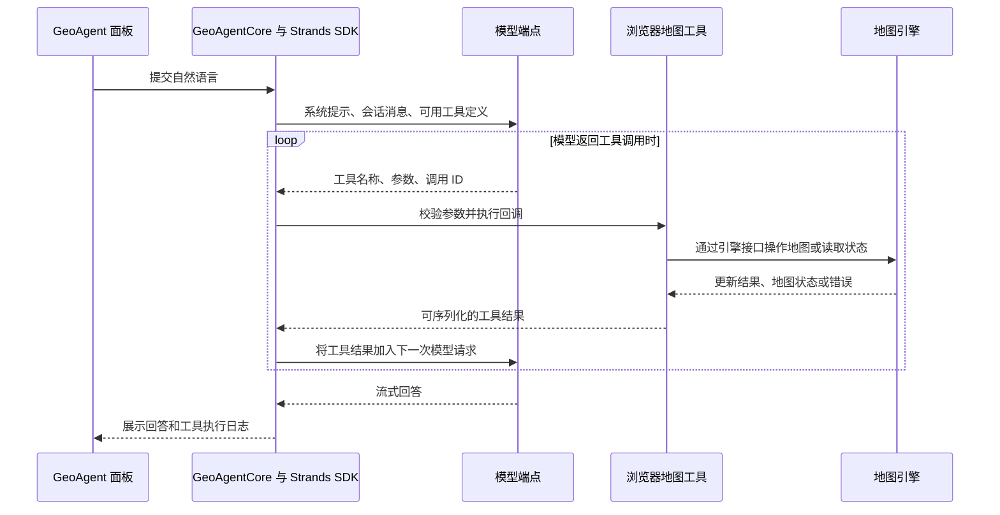

# Web GeoAgent 如何理解意图并执行地图命令

适用项目为 `webmap-agent`，发布包名为 `web-geoagent`。用户提交自然语言后，模型根据系统提示、会话上下文和当前引擎提供的工具定义，决定是否调用工具、调用哪个工具以及填入哪些参数。Strands SDK 调度工具调用，浏览器中的 GeoAgent 负责校验和执行，地图引擎负责更新界面。项目没有独立的关键词路由器或意图分类器。

## 1. 从用户输入到模型请求

原生 `GeoAgentControl` 和 React `GeoAgentPanel` 共享 `GeoAgentCore`。用户按回车或点击发送时，两个入口最终都调用 `core.sendPrompt(text)`。Core 去除首尾空白，忽略空输入或已有任务运行时的重复提交，并把模型输出和工具事件持续写入会话面板。

Core 在绑定地图时校验实际实例是否匹配 `mapEngine.kind`，再由工具工厂创建对应的工具集。首次发送时，Core 根据当前设置创建 Strands `Agent`，通过浏览器调用 OpenAI 兼容 Chat Completions 或 Anthropic 兼容端点。配置和绑定保持一致时，Core 可以复用 Agent，让后续输入引用之前的对话和工具结果。

模型选择工具时依赖以下三类信息。

| 信息 | 作用 |
| --- | --- |
| 系统提示 | 说明业务约定、不同引擎的能力和相近工具的使用场景。 |
| 用户输入与会话上下文 | 提供目标、对象、参数及限制条件。例如，「把刚才的红色标记隐藏」可引用前一轮的标记名称。 |
| 工具定义 | 告诉模型本轮可使用哪些工具，以及每个工具的用途和参数。 |

工具选择由模型生成，同一句输入在不同模型或不同上下文中可能产生不同调用。地图当前中心、图层清单等实时数据由 `get_map_state`、`list_layers` 等工具读取。用户只给地名时，地点解析的准确性也取决于模型和宿主提供的工具。需要精确定位时，输入可以明确提供经纬度。

## 2. 模型如何识别各个工具的能力

Strands SDK 将已注册的工具转成模型 API 支持的工具描述，并随请求发送。模型通过这些字段理解每个工具能做什么、何时使用、怎样填写参数。回调函数保留在浏览器端，由 SDK 在收到工具调用后执行。

| 字段 | 模型看到的信息 | 以 `add_marker` 为例 |
| --- | --- | --- |
| `name` | 工具的调用标识 | 返回工具调用时使用 `add_marker`。 |
| `description` | 工具的用途 | 在浏览器地图上添加一个标记。 |
| `inputSchema` | 参数名、类型与必填要求 | `lat` 和 `lon` 是必填数字，`name` 和 `color` 是可选字符串。 |

工具用途相近时，描述和系统提示共同帮助模型区分使用场景。用户请求「叠加一层卫星影像」时，系统提示建议优先使用 `add_basemap`。用户明确要求「把整套底图换成深色样式」时，系统提示会把模型引向 `change_basemap`。

模型看到的工具清单由当前地图引擎和宿主配置决定。例如，Leaflet 的工具集未注册地图截图，ArcGIS 的工具集注册了 `screenshot_map`。工具清单限定候选项，描述和系统提示帮助模型选择，执行端通过参数校验、权限和引擎实现判断调用能否完成。

相关实现见 [工具定义](src/lib/core/tools/tool-defs.ts)、[工具注册](src/lib/core/tools/geoagent-tools.ts) 和 [系统提示](src/lib/core/GeoAgentCore.ts)。

## 3. 从工具调用到地图执行



工具在 [tool-defs.ts](src/lib/core/tools/tool-defs.ts) 中通过 `tool({ name, description, inputSchema, callback })` 声明。Strands 将 Zod 定义转换为提供给模型的 JSON Schema，并在执行内置 Zod 工具的回调前解析参数。有效的调用会走到 `runCommand(name, input)`。直接调用 `runCommand` 属于宿主程序入口，参数由对应处理器处理，调用过程不经过 SDK 的 Zod 工具包装。

Strands 按顺序调度同一批工具。地图工具自身维护串行队列，避免换底图、添加图层等操作交错修改地图。命令处理器找到对应的执行逻辑后，通过当前引擎的地图接口操作。原生 MapLibre 直接使用其地图 API，Leaflet、OpenLayers 和 ArcGIS 通过各自的适配器承接公共地图命令。需要等待相机移动的命令会等待引擎完成过渡，再让后续命令读取地图。

## 4. 添加上海人民广场标记并定位的示例

> 在上海人民广场添加一个红色标记，经度 121.4750，纬度 31.2323，名称用「人民广场」，然后把地图中心移到那里，缩放级别设为 11。

一种符合该意图的工具调用序列如下。内容为简化示意，具体顺序和是否追加查询由模型根据上下文决定。

```json
[
  {
    "name": "add_marker",
    "input": {
      "lon": 121.475,
      "lat": 31.2323,
      "name": "人民广场",
      "color": "red"
    }
  },
  {
    "name": "set_center",
    "input": { "lon": 121.475, "lat": 31.2323, "zoom": 11 }
  }
]
```

`add_marker` 处理器将命名参数转换为地图内部使用的 `[经度, 纬度]`，构造并挂载标记，同时把它登记到用户图层。随后 `set_center` 更新视角。若用户还要求确认最终中心，模型可以继续调用 `get_map_state` 并根据返回值回答。

## 5. 如何判断命令是否真正执行

模型的自然语言回复和程序的执行日志是两条信息。Core 在 `beforeToolCallEvent` 记录工具名和开始时间，在 `afterToolCallEvent` 根据真实结果记录成功、失败、取消或结果未知。参数类型错误、引擎能力不支持、宿主权限限制及执行失败都可能导致工具请求无法完成。可选 JavaScript 工具默认关闭，运行时权限由宿主配置控制。

排查时可以先看工具日志。只有助手回复时，可以确认本轮有文字输出，但不能仅凭回复判断地图已修改。有工具记录时，应结合工具结果及地图状态一起核对。例如，用户要求隐藏标记时，可以从日志确认调用了 `set_layer_visibility`，再用 `list_layers` 核对对应标记仍存在且 `visible` 为 `false`。

## 源码入口

| 位置 | 职责 |
| --- | --- |
| [GeoAgentCore.ts](src/lib/core/GeoAgentCore.ts) | 接收用户输入，拼装模型上下文，消费流式事件并更新会话 |
| [tool-defs.ts](src/lib/core/tools/tool-defs.ts) | 定义工具名称、用途、参数 Schema 和回调 |
| [tools-factory.ts](src/lib/core/tools/tools-factory.ts) | 根据 `mapEngine.kind` 选择工具实现 |
| [geoagent-tools.ts](src/lib/core/tools/geoagent-tools.ts) | 串行执行命令，管理图层并调用地图引擎 |
| [engines](src/lib/core/engines) | 实现各地图引擎的兼容适配 |
